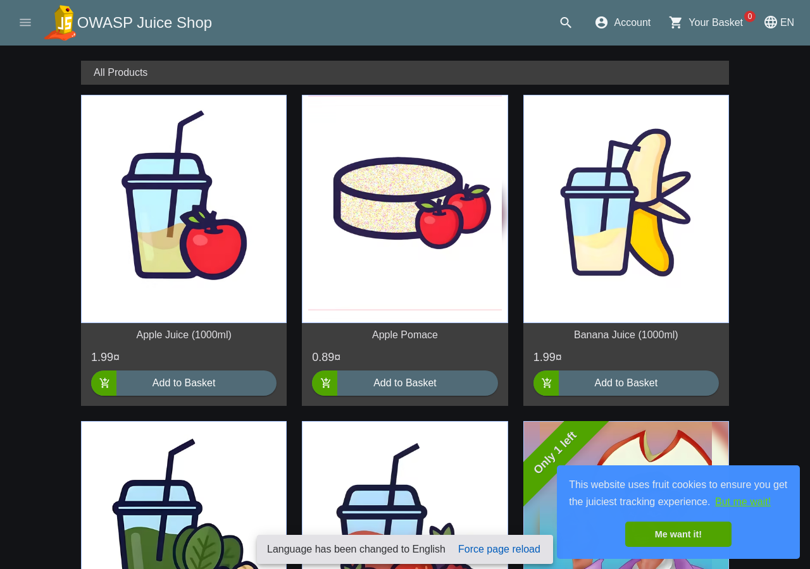

# Day 2 runtime baseline

Observed on **17 October 2026 (Asia/Kolkata)** against the owned `kind-pipelinefortress` lab only. Juice Shop v20.3.0 source commit `f189f521266f42c6bd05884468292000cee852ed` was built with its original Dockerfile. Image config ID: `sha256:79543af23e212f5def487f4daa27763943170f7bb268c46d0aace37920d7ae88`; Linux/amd64, user 65532, port 3000. The Ready pod's CRI manifest reference resolves to that exact config ID. Kubernetes manifest digests and Docker config IDs are different identifiers and are checked separately.

Evidence: [runtime-baseline.json](../reports/sanitized/day2/runtime-baseline.json). Raw HTTP bodies, kubeconfig and deployment logs remain under ignored `reports/private/day2/`. The report publishes status, booleans and response hashes, without raw response contents. These are runtime observations, not scanner verdicts or a detection-rate measurement.

## Confirmed observations

| ID | Safe reproduction in this lab | Actual observation | Expected control | Risk / limitation |
|---|---|---|---|---|
| RT-01 | Unauthenticated `GET http://127.0.0.1:3000/ftp/` | HTTP 200; directory listing contains an internal-document filename | Disable directory indexing; explicitly allow public files and authorize sensitive resources | Reveals available artifacts and supports discovery. No file download, private data extraction or claim about every listed file was needed |
| RT-02 | Unauthenticated `GET http://127.0.0.1:3000/metrics` | HTTP 200 with Prometheus help records and process metrics | Restrict metrics to authenticated monitoring or a separate internal endpoint | Leaks operational information. This owned lab is loopback-accessible; this is not evidence of internet exposure |
| RT-03 | Unauthenticated `GET http://127.0.0.1:3000/rest/products/search?q=%27%29` | HTTP 500 includes `SQLITE_ERROR` and stack details | Parameterize queries and return a generic client error; keep details in protected logs | Discloses implementation details and shows malformed input reaches SQL parsing. This check does not claim successful data extraction, authentication bypass or destructive SQL execution |

The home page also returned HTTP 200. The initial single-quote search probe returned HTTP 200 with no matching products, so it was **not** treated as a confirmed error disclosure; the documented malformed quote/parenthesis probe produced the actual 500 evidence. All probes used GET against the owned target; no external targets were scanned. Juice Shop automatically marks training challenges solved when metrics/error behaviors are observed; those lab-only progress changes are an application side effect of these requests.

## Reproduce and access

```bash
source scripts/dev-env.sh
bash scripts/build-image.sh
bash scripts/deploy.sh
python scripts/runtime-baseline.py
```

The runtime checker opens and closes its own `127.0.0.1:3000` forward. For interactive inspection, leave this command running in a separate terminal, then open the loopback URL:

```bash
KUBECONFIG="$PWD/reports/private/day2/kubeconfig" \
  kubectl --context kind-pipelinefortress -n pipelinefortress \
  port-forward --address 127.0.0.1 service/juice-shop 3000:3000
```

Stop that forward with Ctrl-C. To remove this disposable lab explicitly:

```bash
kind delete cluster --name pipelinefortress \
  --kubeconfig "$PWD/reports/private/day2/kubeconfig"
```

The local cluster is retained for subsequent project work. Hosted CI deletes its own cluster. No module persistence, shell startup or system Node changes are required here. Hardening/remediation, scanners and AI stages belong to later guide checkpoints and have not been claimed complete.

## Running application screenshot



[Capture metadata and SHA-256](../reports/sanitized/day2/screenshot.json). User authorized an isolated headless Playwright context after the browser-control tool reported no available browser. The fresh context blocked non-loopback network requests; no login, purchases or personal data entry occurred. The welcome overlay was dismissed; the non-binding cookie notice remains visible. Image review confirmed the product catalog with no personal identities or credentials.
